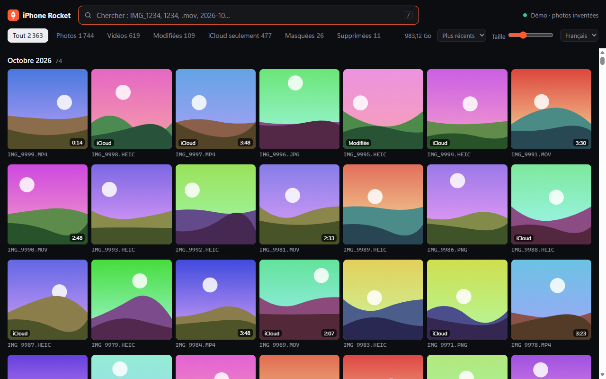
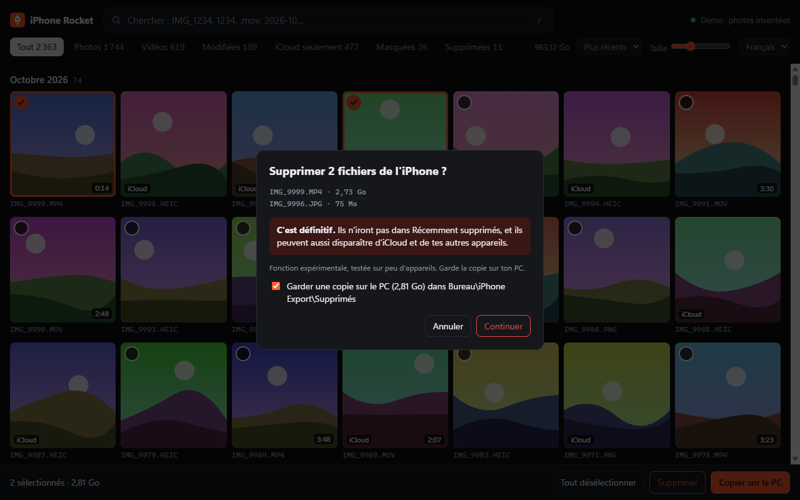

# 🚀 iPhone Rocket

[English](README.md) · **Français**

**Trouve, regarde, copie et supprime les photos et vidéos de ton iPhone sous Windows, en quelques secondes au lieu de plusieurs minutes.**

Ton iPhone est branché, le fichier est bien sur le téléphone, mais l'Explorateur de fichiers ne le montre pas, ou met une éternité ? Cet outil parle directement à l'iPhone par USB, affiche les vrais noms de fichiers et cherche instantanément.



*Capture du mode démo : les images sont inventées.*

Gratuit, open source, sans compte, rien n'est envoyé sur Internet.

## Pourquoi tu ne trouves pas ton fichier dans l'Explorateur

| Ce que tu vois | Ce qui se passe vraiment | Ce que fait iPhone Rocket |
|---|---|---|
| **Le fichier n'apparaît pas** | La liste de l'Explorateur semble figée au moment du branchement. Une vidéo filmée pendant que l'iPhone était branché est restée invisible jusqu'à ce qu'on rebranche le câble. | Revérifie l'iPhone toutes les 10 secondes |
| **Le nom est différent** | Windows affiche des milliers de fichiers sous un autre nom : `IMG_1234.MP4` peut apparaître comme `ABCD5678.MP4`. | Montre les vrais noms de l'iPhone, et cherche aussi dans les noms d'origine |
| **C'est interminable** | Windows demande les détails de chaque fichier un par un. | Lit toute la liste d'un coup |
| **Le fichier n'est pas du tout sur le téléphone** | Avec *Optimiser le stockage*, beaucoup d'originaux ne sont que dans iCloud. | Te le dit, avec un filtre « iCloud seulement » |

Mesuré sur un iPhone avec environ 13 000 éléments :

| | Explorateur | iPhone Rocket |
|---|---|---|
| Lire la liste | 157 s pour un dossier de 1 348 fichiers | **0,12 s pour les 8 783 fichiers** |
| Démarrer | – | **moins de 1 s** après le premier lancement |
| Chercher | – | **environ 30 ms** |

## Fonctionnalités

- **Recherche instantanée** par nom, numéro, extension ou date : `IMG_1234`, `1234`, `.mov`, `2026-10`
- **Grille fluide** de plus de 13 000 éléments, avec les miniatures déjà présentes sur l'iPhone
- **Aperçu** des photos et vidéos, y compris en 4K HEVC si ton PC sait la décoder
- **Copie sur le PC** avec la date d'origine, ou la version modifiée d'une photo ou d'une vidéo
- **Suppression de l'iPhone** (expérimentale, voir plus bas)
- **Filtres** : photos, vidéos, modifiées, iCloud seulement, masquées, supprimées
- **Fonctionne hors ligne** : la dernière liste reste visible quand l'iPhone est débranché
- **Anglais et français**, choisis automatiquement

## Installation

Il te faut **Windows 10 ou 11** et un câble USB. L'outil ne télécharge rien d'autre.

1. Installe **[Python 3](https://www.python.org/downloads/windows/)**. Coche *Add python.exe to PATH* dans l'installeur.
2. Installe **iTunes** depuis le Microsoft Store, pour le pilote USB d'Apple.
3. Sur cette page, clique sur le bouton vert **Code**, puis **Download ZIP**, et décompresse le fichier.
4. Double-clique sur **`Start iPhone Rocket.bat`**.
5. Branche ton iPhone, déverrouille-le et touche **Faire confiance** s'il te le demande.

Le premier lancement prend environ 30 secondes et demande brièvement environ 1 Go d'espace libre. Les suivants sont instantanés.

Pas d'iPhone sous la main ? Essaie `python rocket.py --demo`.

## Raccourcis clavier

| Touche | Action |
|---|---|
| `/` | Chercher |
| `Entrée` | Ouvrir le premier résultat |
| `←` `→` | Précédent / suivant dans l'aperçu |
| `Échap` | Fermer, vider la sélection ou la recherche |
| `Ctrl`+clic, `Maj`+clic | Sélectionner |
| `Ctrl`+`A` | Tout sélectionner à l'écran |

## Supprimer des fichiers (expérimental)



> **La suppression est définitive.** Les fichiers ne vont **pas** dans Récemment supprimés. Comme Photos iCloud synchronise les suppressions, un fichier peut aussi disparaître d'iCloud et de tes autres appareils : ce n'est pas encore vérifié.

- La suppression passe par l'API officielle de Windows : c'est l'iPhone lui-même qui retire le fichier, et sa bibliothèque Photos reste cohérente.
- Avant d'effacer quoi que ce soit, l'outil prouve qu'il vise le bon fichier : taille exacte, extension et date, une seule correspondance, et contrôle du contenu octet par octet jusqu'à 50 Mo. Au moindre doute, il refuse.
- Tu confirmes deux fois, en tapant un mot. Une copie est gardée sur ton PC par défaut, dans `Bureau\iPhone Export\Supprimés`.
- Chaque tentative est notée dans `%LOCALAPPDATA%\iPhoneRocket\deletions.log`.
- 100 fichiers maximum à la fois.
- Testée pour l'instant sur quelques petites images seulement, sur un seul iPhone.

**Non supprimables depuis l'outil :** les éléments modifiés, les Live Photos, les éléments masqués, ceux dans Récemment supprimés et ceux seulement dans iCloud. Supprime-les dans l'app Photos de l'iPhone.

## Vie privée

- **Rien ne quitte ton PC.** L'outil écoute uniquement sur `127.0.0.1`, et les sites web ne peuvent pas l'atteindre.
- **La connexion directe est en lecture seule.** Elle ne peut pas modifier l'iPhone ; seul le bouton de suppression le peut, après ta confirmation.
- Les miniatures et les listes restent dans `%LOCALAPPDATA%\iPhoneRocket`. Supprime ce dossier pour les effacer.

Détails dans [SECURITY.md](SECURITY.md).

## Dépannage

**« Le service Apple est arrêté »**
Clique sur **Démarrer le service** et accepte la fenêtre Windows, **puis débranche et rebranche l'iPhone**. Le service ne voit que les appareils branchés après son démarrage.

**« Branche ton iPhone » alors qu'il est branché**
Déverrouille-le, débranche-le et rebranche-le. Vérifie que tu as bien touché **Faire confiance**.

**Un fichier est listé mais ne se copie pas**
Il porte l'étiquette *iCloud* : l'original n'est pas sur l'iPhone. Ouvre-le dans l'app Photos de l'iPhone pour le télécharger. Il apparaîtra ensuite comme un fichier normal.

**Un fichier de WhatsApp ou de l'app Fichiers est absent**
Par USB, un iPhone n'expose que sa bibliothèque Photos. Les fichiers des autres apps sont inaccessibles, sauf si tu les as enregistrés dans Photos.

**La vidéo n'a pas d'image**
Ton PC n'a peut-être pas de décodeur HEVC. Copie la vidéo sur le PC et ouvre-la avec [VLC](https://www.videolan.org/fr/).

**« Introuvable côté Windows » en supprimant**
Débranche et rebranche l'iPhone, puis réessaie : la liste de Windows n'est probablement plus à jour.

## Limites

- Windows uniquement.
- Testé sur un seul iPhone pour l'instant : voir plus bas. **[Dis-nous comment ça marche sur le tien](CONTRIBUTING.fr.md)**.
- Les photos HEIC ont un aperçu réduit. La copie est en pleine qualité.
- Python doit être installé : un `.exe` prêt à lancer est la prochaine étape.

## Testé sur

| iPhone | iOS | Windows | Python |
|---|---|---|---|
| iPhone 15 Pro Max | 26.7.1 | Windows 11 Pro (anglais) | 3.12, 3.14 |

## Comment ça marche

```
Fenêtre du navigateur  <->  rocket.py (serveur local sur 127.0.0.1)
                              |-- iphone.py     usbmuxd -> lockdownd -> AFC       lecture seule, rapide
                              '-- wpd-map.cs    comment Windows voit les fichiers  liste, et supprime sur demande
```

Le tout utilise la bibliothèque standard de Python, sans aucune dépendance. Le plan du projet est dans [CONTRIBUTING.fr.md](CONTRIBUTING.fr.md).

## Contribuer

Les signalements de bugs sont les bienvenus, surtout avec le modèle de ton iPhone et ta version d'iOS. Voir [CONTRIBUTING.fr.md](CONTRIBUTING.fr.md).

## Licence

[MIT](LICENSE) © 2026 Mohamed Kondombo. Fourni « tel quel », sans garantie : garde une sauvegarde de ce qui compte pour toi.

*iPhone Rocket est un projet indépendant. Il n'est ni affilié à Apple Inc., ni approuvé ou sponsorisé par Apple Inc. iPhone, iCloud et iTunes sont des marques d'Apple Inc.*
