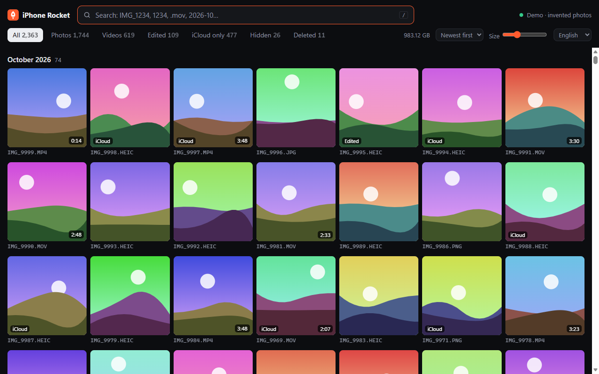
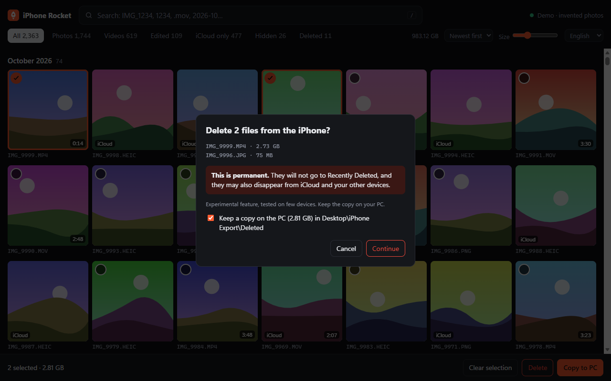

# 🚀 iPhone Rocket

**English** · [Français](README.fr.md)

**Find, preview, copy and delete your iPhone photos and videos on Windows, in seconds instead of minutes.**

Your iPhone is plugged in, the file is on the phone, but File Explorer does not show it, or takes forever? This tool talks directly to the iPhone over USB, shows its real file names, and searches instantly.



*Screenshot from demo mode: the images are invented.*

Free, open source, no account, nothing is sent to the Internet.

## Why you can't find your file in File Explorer

| What you see | What really happens | What iPhone Rocket does |
|---|---|---|
| **The file is missing** | Explorer's list seems frozen when you plug the phone in. A video filmed while plugged in stayed invisible until the cable was reconnected. | Checks the iPhone again every 10 seconds |
| **The name is different** | Windows shows thousands of files under another name: `IMG_1234.MP4` can appear as `ABCD5678.MP4`. | Shows the iPhone's real names, and searches original names too |
| **It takes forever** | Windows asks for each file's details one by one. | Reads the whole list in one go |
| **The file isn't on the phone at all** | With *Optimize iPhone Storage*, many originals are only in iCloud. | Tells you, with an "iCloud only" filter |

Measured on one iPhone with about 13,000 items:

| | File Explorer | iPhone Rocket |
|---|---|---|
| Reading the list | 157 s for one folder of 1,348 files | **0.12 s for all 8,783 files** |
| Starting up | – | **under 1 s** after the first launch |
| Searching | – | **about 30 ms** |

## Features

- **Instant search** by name, number, extension or date: `IMG_1234`, `1234`, `.mov`, `2026-10`
- **Smooth grid** of 13,000+ items, using the thumbnails already on the iPhone
- **Preview** photos and videos, including 4K HEVC if your PC can decode it
- **Copy to PC** with the original date, or the edited version of a photo or video
- **Delete from the iPhone** (experimental, see below)
- **Filters**: photos, videos, edited, iCloud only, hidden, deleted
- **Works offline**: the last list stays visible when the iPhone is unplugged
- **English and French**, chosen automatically

## Install

You need **Windows 10 or 11** and a USB cable. Nothing else is downloaded by the tool.

1. Install **[Python 3](https://www.python.org/downloads/windows/)**. Tick *Add python.exe to PATH* in the installer.
2. Install **iTunes** from the Microsoft Store, for Apple's USB driver.
3. On this page, click the green **Code** button, then **Download ZIP**, and unzip it.
4. Double-click **`Start iPhone Rocket.bat`**.
5. Plug in your iPhone, unlock it and tap **Trust** if it asks.

The first launch takes about 30 seconds and briefly needs about 1 GB of free disk space. The next ones are instant.

No iPhone at hand? Try `python rocket.py --demo`.

## Keyboard shortcuts

| Key | Action |
|---|---|
| `/` | Search |
| `Enter` | Open the first result |
| `←` `→` | Previous / next in preview |
| `Esc` | Close, clear the selection or the search |
| `Ctrl`+click, `Shift`+click | Select |
| `Ctrl`+`A` | Select everything shown |

## Deleting files (experimental)



> **Deletion is permanent.** Files do **not** go to Recently Deleted. Because iCloud Photos syncs deletions, a file may also disappear from iCloud and from your other devices: this has not been verified yet.

- Deletion goes through Windows' official device API: the iPhone itself removes the file, and its Photos library stays consistent.
- Before erasing anything, the tool proves it targets the right file: exact size, extension and date, a single match, and a byte-by-byte content check up to 50 MB. In any doubt, it refuses.
- You confirm twice, by typing a word. A copy is kept on your PC by default, in `Desktop\iPhone Export\Deleted`.
- Every attempt is recorded in `%LOCALAPPDATA%\iPhoneRocket\deletions.log`.
- At most 100 files at a time.
- So far, tested only on a few small images, on one iPhone.

**Not deletable from the tool:** edited items, Live Photos, hidden items, items in Recently Deleted and iCloud-only items. Delete those in the Photos app on the iPhone.

## Privacy

- **Nothing leaves your PC.** The tool only listens on `127.0.0.1`, and websites cannot reach it.
- **The direct connection is read-only.** It cannot modify the iPhone; only the delete button can, after your confirmation.
- Thumbnails and file lists stay in `%LOCALAPPDATA%\iPhoneRocket`. Delete this folder to erase them.

See [SECURITY.md](SECURITY.md) for details.

## Troubleshooting

**"The Apple service is stopped"**
Click **Start the service** and accept the Windows prompt, **then unplug the iPhone and plug it back in**. The service only sees devices plugged in after it starts.

**"Plug in your iPhone", but it is plugged in**
Unlock it, unplug it and plug it back in. Check that you tapped **Trust**.

**A file is listed but cannot be copied**
It has the *iCloud* tag: the original is not on the iPhone. Open it in the Photos app on the iPhone to download it. It will then appear as a normal file.

**A file from WhatsApp or the Files app is missing**
Over USB, an iPhone only exposes its Photos library. Other apps' files are out of reach, unless you saved them to Photos.

**The video has no picture**
Your PC may lack an HEVC decoder. Copy the video to the PC and open it with [VLC](https://www.videolan.org/).

**"Not found on the Windows side" when deleting**
Unplug the iPhone and plug it back in, then try again: Windows' list is probably out of date.

## Limitations

- Windows only.
- Tested on a single iPhone so far: see below. **[Please tell us how it works on yours](CONTRIBUTING.md)**.
- HEIC photos show a reduced preview. The copy is full quality.
- Python must be installed: a ready-to-run `.exe` is the next step.

## Tested on

| iPhone | iOS | Windows | Python |
|---|---|---|---|
| iPhone 15 Pro Max | 26.7.1 | Windows 11 Pro (English) | 3.12, 3.14 |

## How it works

```
Browser window  <->  rocket.py (local server on 127.0.0.1)
                       |-- iphone.py     usbmuxd -> lockdownd -> AFC    read-only, fast
                       '-- wpd-map.cs    how Windows sees the files     lists, and deletes on request
```

The whole thing uses Python's standard library, with no dependency. See [CONTRIBUTING.md](CONTRIBUTING.md) for the project map.

## Contributing

Bug reports are very welcome, especially with your iPhone model and iOS version. See [CONTRIBUTING.md](CONTRIBUTING.md).

## License

[MIT](LICENSE) © 2026 Mohamed Kondombo. Provided "as is", without warranty: keep a backup of what matters to you.

*iPhone Rocket is an independent project. It is not affiliated with, endorsed by or sponsored by Apple Inc. iPhone, iCloud and iTunes are trademarks of Apple Inc.*
